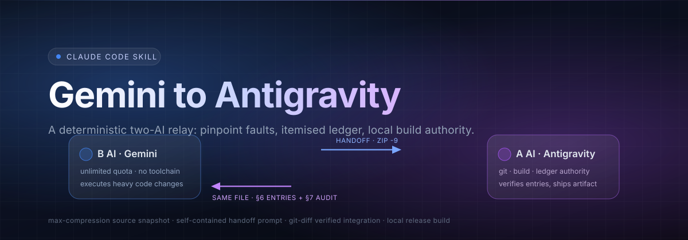
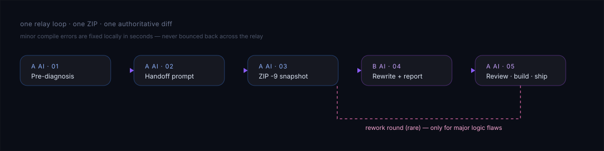

<div align="center">



# Gemini to Antigravity

**A deterministic two-AI relay: unlimited remote quota, local build authority.**

[](LICENSE)
[](SKILL.md)
[](https://docs.claude.com/en/docs/claude-code/skills)
[](#privacy--security)
[](CONTRIBUTING.md)

[English](README.md) · [简体中文](README.zh-CN.md) · [Quick Start](#quick-start-in-60-seconds) · [Skill Spec](SKILL.md) · [Protocol](docs/PROTOCOL.md) · [Install](docs/AGENT-INTEGRATION.md)

</div>

<details>
<summary><b>Contents</b></summary>

- [Why this exists](#why-this-exists)
- [The problem it solves](#the-problem-it-solves)
- [How it works](#how-it-works)
- [Quick start in 60 seconds](#quick-start-in-60-seconds)
- [The ledger model](#the-ledger-model)
- [What makes it rigorous](#what-makes-it-rigorous)
- [Recipes](#recipes)
- [Cost & latency model](#cost--latency-model)
- [Threat model](#threat-model)
- [Repository layout](#repository-layout)
- [The return contract](#the-return-contract)
- [Compatibility](#compatibility)
- [Design principles](#design-principles)
- [Privacy & security](#privacy--security)
- [FAQ](#faq)
- [Roadmap](#roadmap)
- [Contributing](#contributing)
- [License](#license)

</details>

---

## Why this exists

Every serious coding agent hits the same wall: the model with the *best* reasoning has a metered quota, and the model with the *unlimited* quota cannot compile anything. You end up shuttling diffs by hand, losing context, and discovering at the very end that nothing builds.

**Gemini to Antigravity** formalizes that shuttle into a protocol.

The local agent — **A AI** (*Antigravity*: it holds the repository, the compiler, and the release gate) — owns diagnosis, review, and the build. The remote agent — **B AI** (*Gemini*: effectively unlimited compute budget, zero local toolchain) — owns bulk code mutation. The two are joined by exactly two artifacts:

```
one handoff ZIP   ─────────────────────────▶   B AI
one result ZIP    ◀─────────────────────────   B AI
```

Everything else — location conventions, the itemised ledger, execution rules, error triage — is encoded so neither side can drift.

> The name is the contract. *Gemini* is the engine you borrow. *Antigravity* is the ground you never leave: your repo, your `git diff`, your build output, your signature on the release.

**The central idea is the ledger.** A AI does not write a description of the task; it writes numbered, located claims — `F-01 · src/core/scheduler.ts:112-140 — paused tasks reach execute() and dereference a disposed handler` — and no remedy. B AI must close every ID one at a time, appending an entry to the same document as it goes, then audit all of them before returning. A AI checks the ledger against the diff with a script before it reads a single line of code. Laziness stops being a matter of opinion: it becomes a missing ID.

---

## The problem it solves

| Pain | Without this skill | With this skill |
| --- | --- | --- |
| **Quota exhaustion** | Burn your frontier-model quota on 400-line refactors | Push bulk work to an unlimited-quota model |
| **No toolchain remotely** | Remote model writes plausible code that never compiles | Local side always compiles, typechecks, and packages |
| **Blind trust** | You accept a remote "it's done" message | `git diff` is the source of truth, not the claim |
| **Quiet laziness** | "All items addressed" — three of six actually done | Every ID has an entry, a status, and a line reference; `check_ledger.py` names what is missing |
| **Vague handoffs** | "The scheduler has a bug somewhere" | Every fault carries a file, and a line range when known |
| **Remedy anchoring** | The prompt sketches the fix; the model implements the sketch, right or wrong | The prompt states only the problem; the model must derive |
| **Context loss** | Remote model forgot the architecture halfway through | `GEMINI_HANDOFF.md` is self-contained by design |
| **Relay ping-pong** | Three round trips to fix one missing import | Mechanical fixes are patched locally in seconds |
| **Archive hygiene** | `node_modules/` bloats the ZIP to 300 MB | Excluded by a named, auditable denylist |
| **Wrapper folders** | Files land one directory too deep and silently overwrite nothing | Staging extraction normalizes the root first |
| **Unclean history** | `GEMINI_HANDOFF.md` ends up committed | Handoff artifacts are explicitly untracked |

---

## How it works

<div align="center">

</div>

```
┌──────────────────────────── Phase 1 · Outbound ────────────────────────────┐
│                                                                            │
│   ①  Pre-diagnosis        Read source, logs, traces                         │
│                           Assign F-nn (located fault, no remedy)             │
│                                   U-nn (verbatim requirement + acceptance)   │
│                                   S-nn (suspect area + the question)         │
│                                     │                                      │
│   ②  Handoff ledger       GEMINI_HANDOFF.md §1-§8 at ZIP root               │
│                           → faults, requirements, suspects, 8 rules          │
│                                     │                                      │
│   ③  Package              ZIP_DEFLATED, compresslevel = 9                   │
│                           exclude .git, node_modules, build, dist, ...      │
│                                     │                                      │
└─────────────────────────────────────┼──────────────────────────────────────┘
                                      ▼
                     ┌─────────────────────────────────────┐
                     │   B AI / ZIP                        │
                     │   per ID: fix → append §6 entry     │
                     │   before return: complete §7 audit  │
                     └────────────────┬────────────────────┘
                                      ▼
┌──────────────────────────── Phase 2 · Inbound ─────────────────────────────┐
│                                                                            │
│   ④  Safety checkpoint    git status → commit / named stash                 │
│                                     │                                      │
│   ⑤  Staged extraction    inspect layout → normalize wrapper folder          │
│                           read §6 and §7 in full                            │
│                                     │                                      │
│   ⑥  Ledger check         check_ledger.py: every ID has an entry + status   │
│                           missing / duplicate / malformed → REWORK           │
│                                     │                                      │
│   ⑦  Diff review          git status · git diff --stat · git diff            │
│                           each DONE must land on the lines it claims         │
│                                     │                                      │
│   ⑧  Build gate           typecheck → compile → test → release artifact     │
│                                     │                                      │
│   ⑨  Triage               mechanical  → fix locally, rebuild                │
│                           structural  → append §9 death record, rework      │
└────────────────────────────────────────────────────────────────────────────┘
```

---

## Quick start in 60 seconds

### Install

```bash
# Personal skills (available in every project)
git clone https://github.com/HIMKUG/gemini-to-antigravity.git \
  ~/.claude/skills/gemini-to-antigravity
```

```powershell
# Windows (PowerShell)
git clone https://github.com/HIMKUG/gemini-to-antigravity.git "$env:USERPROFILE\.claude\skills\gemini-to-antigravity"
```

Or drop the folder into `.claude/skills/` inside a single project to scope it there.

Verify it loaded:

```bash
claude --debug 2>&1 | grep -i gemini-to-antigravity
```

### Use it — outbound

> "Package this repo for Gemini. The crash is in `src/core/scheduler.ts:112`. Hand off the fix and ask it to audit the retry path too."

What happens: pre-diagnosis → `GEMINI_HANDOFF.md` → `repo-handoff-<date>.zip` at maximum compression → exact path and byte size printed for you to upload.

### Use it — inbound

> "Here's the ZIP Gemini sent back. Apply it, review the diff, and build the release APK."

What happens: checkpoint → staged extract → overwrite → `git diff` review → build → local triage → release path reported.

---

## The ledger model

Three ID namespaces, assigned by A AI, never reused:

| Prefix | Meaning | Declared in | Must contain |
| --- | --- | --- | --- |
| `F-nn` | **Confirmed fault** — reproduced locally | §2 | locator, problem, evidence, must-not |
| `U-nn` | **User requirement** — one sentence of the request, restated | §3 | verbatim fragment, acceptance test |
| `S-nn` | **Suspect area** — a hypothesis | §4 | locator, why suspect, what to check |
| `X-nn` | **Declared drift** — a change outside the IDs | §6 | justification |

Every `F` and `S` heading ends with the most specific locator available — a line
range, a single line, or a bare file path. No locator means the item is a
suspect, not a fault. B AI closes every ID with exactly one entry and one audit
row; A AI never accepts a round where an ID is absent.


### 1 · The handoff prompt is self-contained by contract

B AI has no memory of this skill, this repository, or your earlier conversation. Every invariant it must honor lives inside `GEMINI_HANDOFF.md`:

| Section | Guarantee |
| --- | --- |
| **§1 User request (verbatim)** | No paraphrase drift — the requirement survives transport byte-for-byte |
| **§2 Fault ledger (`F-nn`)** | Locator in the heading, problem statement, evidence, and the boundary not to cross. No remedy. |
| **§3 Requirement ledger (`U-nn`)** | Each user sentence restated as an observable acceptance test |
| **§4 Suspect areas (`S-nn`)** | Named blind spots with the specific question B AI must answer, even if the answer is "clean" |
| **§5 Execution rules** | Eight rules written into the file: append per ID, never merge IDs, never edit an unlisted file |
| **§6 Execution ledger** | One entry per ID, written as the work happens, with files, lines, and verification |
| **§7 Self-audit** | One row per ID; every `DONE` must point at the lines that prove it |
| **§8 Return contract** | The same file back, §6 and §7 filled — no separate report to summarize in |

### 1b · Locate or downgrade

A fault that cannot be located is not a fault, it is a hypothesis.

```
### F-01 · src/core/scheduler.ts:112-140     ← line range known
### F-02 · src/core/scheduler.ts:131          ← single line known
### F-03 · src/core/scheduler.ts              ← file known, line unknown
### S-01 · src/core/queue.ts                  ← unverified → suspect, never a fault
```

This one rule removes the most common failure in agent handoffs: a confident
paragraph that names no file, which the remote model then "fixes" somewhere
plausible. Without a locator there is nothing to verify against, so the item is
downgraded to a suspect and must be answered rather than silently closed.

### 1c · Problem, never remedy

An `F-nn` states what the code does, what it must do, what triggers the failure,
and what breaks. It states no patch and no target API.

The reason is review integrity. A stated remedy turns the review into a check
of whether B AI implemented *your* idea; a stated problem turns it into a check
of whether the fault is gone. The second is the only question that matters, and
it is the one that cannot be gamed by agreeing with the prompt.

### 2 · The archive is a specification, not a dump

| Included | Excluded (denylist) |
| --- | --- |
| Full source tree, all configs, lockfiles, assets | `.git/` |
| `GEMINI_HANDOFF.md` at root | `node_modules/`, `.venv/`, `__pycache__/` |
| `.gitignore`-relevant source files | `target/`, `build/`, `dist/`, `.gradle/`, `.dart_tool/` |
| Relative directory layout, byte-exact | `.idea/`, `.vs/`, `.DS_Store` |

Compression: `zipfile.ZIP_DEFLATED` at `compresslevel=9` (cross-platform, no external binary), or `zip -9 -r` where available. The ZIP is verified post-write: root-level `GEMINI_HANDOFF.md`, preserved relative layout.

### 3 · Integration is a two-key operation

You never extract a remote archive straight into your working tree. Two gates:

1. **Safety checkpoint** — `git status` first; commit or create a named stash so the pre-overwrite state is always recoverable.
2. **Staged extraction** — unpack into a temp directory, detect a wrapper folder (`project_name/`), normalize the source root, read §6 and §7 *before* copying a single file.

### 4 · The ledger check runs before the review

```bash
python scripts/check_ledger.py returned/GEMINI_HANDOFF.md --strict
```

The script declares every ID from §2–§4 and asserts:

- each has exactly one §6 entry, with a valid `STATUS`
- each has exactly one §7 row, carrying the same status as §6
- every `DONE` names files and lines
- every `FAILED` names a blocker and a stopping point
- no duplicate IDs, no undeclared entries

Exit `1` on any violation, with the offending IDs printed. This runs in a second,
before a single line of diff is read — so a lazy round fails in a second, not
after a full review.

### 5 · Git is the judge

The ledger is a *claim*. `git diff` is the *evidence*. Both are checked, in order:

- `check_ledger.py` first — completeness is cheap to check, so check it first
- `git status` and `git diff --stat` for the blast radius
- full `git diff` for intent
- every `DONE` entry must land on the lines it claims
- cross-check against §2 (faults), §3 (acceptance tests), and the verbatim request
- explicit hunting for truncation, reformat noise, and out-of-scope edits

A `DONE` whose lines are untouched by the diff is a false claim, and is treated
as a missing ID in the rework round.

### 6 · Error triage is a decision, not a reflex

| Class | Examples | Action |
| --- | --- | --- |
| **Mechanical** | missing import, forgotten dependency, syntax typo, visibility mismatch | Fix locally, rebuild, ship |
| **Structural** | an `F-nn` not fixed, a `U-nn` unmet, an `S-nn` unaddressed, an entry contradicting the diff | Stop patching; append §9; resend |

A missing import costs seconds locally and a full human relay round remotely. The protocol forbids bouncing it — and a round that fails the ledger check never consumes a rework slot, because it never reached review.

### 7 · Rework appends a death record

A failed round is not rewritten; it is **extended**. §9 is appended to the same
file B AI must keep writing in:

```markdown
## 9. Round 2 — Death Record (written by A AI)

### Claims that failed
- F-01: §6 says DONE at `scheduler.ts:112-140`. `git diff` shows no change there.
- F-03: no entry at all. Not attempted.

### Build evidence
<verbatim compiler output, trimmed to the failing lines>

### Drift
<files changed whose paths appear in no entry, with the line ranges>

### What to do this round
Re-open only the IDs above; keep the entries you already wrote; append new
entries for the rework.
```

B AI now reads its own failure, one ID at a time, in a document it must continue
to append to. This is the intended pressure: a lazily finished round costs a
full document of its own mistakes, written in the same place the work is judged.

---

## Recipes

Copy-pasteable prompts for the four situations this protocol exists for.

### Recipe A · Fix an intermittent crash

```text
Outbound: "Package for Gemini. F-01 is src/core/scheduler.ts:112-140 — paused
tasks reach execute() and dereference a disposed handler. S-01: the queue
dequeue path. Close every ID, append the ledger, run the self-audit."
Inbound : "Stage, check_ledger.py, review the diff, typecheck, run the tests, build."
```
Triage rule in play: a missing import that appears during the build is patched locally, never bounced.

### Recipe B · Greenfield feature on an unlimited quota

```text
Outbound: "Hand off the settings-screen feature. U-01..U-04 restate what the
user asked for. S-01: navigation registry. S-02: theme tokens.
Deliver the full tree; any deletion needs its own entry and a justification."
Inbound : "Stage, check the ledger, diff for scope creep, then build and smoke-test."
```
Greenfield rounds have no `F-nn`, so the `S-nn` audit is your tripwire: a task with three suspects and no §6 entries for them is a round that never looked.

### Recipe C · Mechanical sweep (rename, format, dependency bump)

```text
Outbound: "Rename TaskHandler → JobHandler across the repo. U-01: every
reference compiles. S-01..S-03: the three dynamic-lookup sites.
Return the full tree; skip files that never mention the symbol."
Inbound : "Apply, then confirm each DONE lands on the lines it claims, and that
git diff --stat matches the grep count you measured locally."
```
A sweep is the best place to diff-review aggressively: any edit outside the symbol's references is drift, and drift is visible as a file whose path appears in no entry.

### Recipe D · Port or migration

```text
Outbound: "Port src/legacy/export.ts from CommonJS to ESM. F-01..F-06 are the
six call sites, located by line. S-01: dynamic requires. S-02: barrel files."
Inbound : "Apply, review each import rewrite, then run the full package build."
```
Ports fail through *omission*, so read the self-audit first: six `F-nn` entries with four `NOT-APPLICABLE` and no reason is a round that skipped its own checks.

---

## Cost & latency model

Why the two-ARTIFACT design beats ad-hoc copy-paste:

| Factor | Ad-hoc chat copy-paste | This protocol |
| --- | --- | --- |
| Tokens spent on frontier model | Large — you re-explain the repo each round | Small — frontier model sees only the reviewed diff |
| Tokens spent on remote model | You pay per paste, with lossy formatting | One `-9` archive, structure intact |
| Round trips for a mechanical error | 2–3 | 0 — patched locally |
| Round trips for a structural error | 2+ with lost context | 1, with logs and diff excerpts attached |
| Human attention per round | Re-paste, re-explain, re-trust | Review the diff, approve or reject |
| Reproducibility | None — each paste differs | Archive + verbatim request = auditable |

The archive is the unit of work. Everything else is a review step on that unit.

---

## Threat model

What this protocol defends against, and what it does not.

| Threat | Mitigation | Residual risk |
| --- | --- | --- |
| Secret leakage into the handoff | Denylist of `.env*`, `*.pem`, `*.key`, plus a post-write scan in the packager | A secret hiding under an unusual filename |
| Destructive overwrite | Git checkpoint before any write; staged extraction | Uncommitted local work that was never stashed |
| Silent file deletion | A deletion requires an entry naming its path | A file deleted without an entry — caught by `git status` and the drift check |
| Out-of-scope mutation | Full `git diff` review; any unnamed file is drift | Review fatigue on very large diffs — split large handoffs |
| Claimed work that was not done | `check_ledger.py` plus line-level verification of every `DONE` | A `DONE` that names real lines but edits them wrongly — caught by review and tests |
| Broken remote code shipped | Build gate is local and mandatory | A build that passes while the behavior is wrong — covered by tests |
| Supply-chain injection | Every new package must be named in an entry before it enters the build | A dependency added but not reported — caught by lockfile diff |
| Archive bomb / huge ZIP | Exclusion list plus a byte-size report | Binary assets that legitimately belong in the archive |

Not defended: a malicious remote model that writes backdoor logic inside the requested change. The diff review and tests are your only controls there; read the diff, never the summary.

---

## Repository layout

```
gemini-to-antigravity/
├── SKILL.md                      # The skill: agent-facing specification
├── README.md                     # This document
├── README.zh-CN.md               # 简体中文版
├── LICENSE                       # MIT
├── assets/
│   ├── banner.svg                # README header
│   └── flow.svg                  # Relay diagram
├── examples/
│   ├── GEMINI_HANDOFF.example.md # Filled outbound + returned ledger
│   └── GEMINI_HANDOFF.lazy-round.md # Deliberately bad return, for calibration
├── scripts/
│   ├── pack_handoff.py           # ZIP -9 packager + post-write verification
│   └── check_ledger.py           # Ledger completeness gate, runs before review
├── docs/
│   ├── PROTOCOL.md               # Formal invariants, state machine, conformance
│   ├── AGENT-INTEGRATION.md      # Install into Claude Code, Cursor, Codex, MCP
│   ├── COMPARISON.md             # Versus copy-paste, patch relay, branch handoff
│   └── OPERATIONS.md             # Round sizing, scheduling, escalation runbook
└── .github/workflows/validate.yml # CI: schemas, packager smoke test, links
```

| Document | Read it when |
| --- | --- |
| [SKILL.md](SKILL.md) | You are an agent executing a relay round |
| [docs/PROTOCOL.md](docs/PROTOCOL.md) | You need the formal invariants or a conformance checklist |
| [docs/AGENT-INTEGRATION.md](docs/AGENT-INTEGRATION.md) | You are installing this into a runtime |
| [docs/COMPARISON.md](docs/COMPARISON.md) | You are deciding whether this protocol fits |
| [docs/OPERATIONS.md](docs/OPERATIONS.md) | A round failed, or you are planning several |
| [examples/](examples) | You want a filled-out handoff and report to copy |
| [CHANGELOG.md](CHANGELOG.md) | You want to know what changed and why |

---

## The return contract

B AI returns exactly one ZIP:

```text
<result>.zip
├── <source tree, unchanged relative layout>
└── GEMINI_HANDOFF.md      # the same file, §6 and §7 now filled
```

There is no separate report. The file A AI wrote is the file B AI finishes, which
means the requirements, the ledger, the audit, and the rework record all live in
one place — and none of them can be summarized away.

Entry shape in §6:

```markdown
### F-01
- **STATUS:** DONE            # or FAILED / NOT-APPLICABLE
- **Files:** src/core/scheduler.ts
- **Lines:** 112-136
- **Change:** paused tasks are excluded before the due check; stale nextRunAt
  is preserved so a resume still works.
- **Verified:** repro test passes; paused task no longer reaches execute().
```

A failed entry is an acceptable entry — provided it is specific:

```markdown
### U-03
- **STATUS:** FAILED
- **Blocker:** release build needs the Android SDK, absent from this ZIP.
- **Stopped at:** build.gradle.kts:41
- **Tried:** gradle assembleRelease offline; dependency resolution failed.
```

The contract that makes this enforceable: an ID with no entry is an incomplete
round, and an entry whose lines the diff does not touch is a false claim.

---

## Compatibility

| Surface | Support |
| --- | --- |
| Claude Code (CLI / desktop / IDE) | ✅ Skills auto-discovered from `~/.claude/skills` |
| Any agent runtime reading `SKILL.md` | ✅ Plain-markdown YAML frontmatter |
| Repository languages | ✅ Language-agnostic — TypeScript, Python, Rust, Kotlin, Dart, C++, anything |
| Release targets | ✅ Binaries, installers, APKs, bundles, containers |
| OS | ✅ Windows, macOS, Linux |
| Network | ❌ None required — the relay is file-based by design |

---

## Design principles

1. **Local authority is non-negotiable.** The side with the compiler always has the final word.
2. **Locate or downgrade.** A finding without a file is a hypothesis, and is filed as one.
3. **State the problem, never the remedy.** A prescribed fix destroys the independence of the review.
4. **One item, one entry.** Summaries are where work goes missing; numbered entries are where it cannot.
5. **Artifacts over promises.** A ZIP, a ledger, and a diff outrank any prose claim of completion.
6. **Every rule travels with the payload.** Self-contained prompts beat implicit context.
7. **Cheap fixes stay cheap.** Mechanical errors never justify a relay round.
8. **Smallest clean archive.** Excluded bytes are excluded risk.
9. **Reversible by default.** Safety checkpoint before every overwrite.
10. **No hidden state.** The whole protocol is readable markdown in this repo.

---

## Privacy & security

- **No telemetry.** The skill makes no network calls and reports nothing anywhere.
- **No credentials.** Handoff artifacts contain source code only — never `.env`, tokens, or keys. Add your own secret patterns to the denylist when packing sensitive repos.
- **Human-in-the-loop transfer.** You move the ZIP yourself; nothing is uploaded automatically.
- **Untracked handoff files.** `GEMINI_HANDOFF.md` is kept out of commits so repository history stays clean.

---

## FAQ

**Why not just use one model with a bigger quota?**
Because quota and toolchain rarely co-locate. This protocol lets you compose the best of both without losing the release gate.

**Can A AI be any local agent?**
Yes. Anything that can read/write files, run `git`, and execute a build qualifies. `SKILL.md` is model-agnostic.

**Can B AI be something other than Gemini?**
Yes — any remote model that accepts a ZIP and returns a ZIP. The contract is the interface.

**How large can a handoff get?**
Bounded by source size after exclusions, typically a few megabytes. Binary assets are the practical limit; consider a manifest for very large media.

**What if B AI returns a wrapper folder?**
Expected. Staged extraction normalizes it. This is the single most common remote-ZIP failure mode and it is explicitly handled.

**What if B AI deletes a file I need?**
A deletion is legal only when a §6 entry names the path. Anything deleted without an entry is a protocol violation, surfaced by `git status` and the drift check.

**How do I know B AI actually did all of it?**
Run `check_ledger.py`. It lists every declared ID, asserts each has one entry and one audit row, and flags any `DONE` without files and lines. A missing ID means the work was not attempted, which is the honest thing to learn in the first second rather than after reading a confident summary.

**Why no separate change report?**
Because a report is a summary, and a summary is the easiest place to claim work without doing it. The ledger forces one entry per item, written as the item is finished, in the same document carrying the requirements.

**Why not tell B AI how to fix it?**
Because then the review checks whether B AI followed your guess, not whether the fault is gone. Problem-only prompts make the review answer the question that actually matters.

**Does this work for monorepos?**
Yes. The exclusion list is path-relative and the layout is preserved verbatim, so workspace structure survives intact.

**Is there an automated packager?**
Yes — [`scripts/pack_handoff.py`](scripts/pack_handoff.py) writes a `-9` archive with the default denylist, then verifies the handoff file is at the root and that no secret-bearing file leaked in.

**Is there an automated ledger check?**
Yes — [`scripts/check_ledger.py`](scripts/check_ledger.py), dependency-free, exit code `1` on any missing or malformed ID. Run it before reading the diff, never after.

---

## Roadmap

- [x] Ledger completeness gate for returned handoffs (`check_ledger.py`)
- [x] Per-item self-audit table with line-level evidence
- [x] Rework rounds that append a death record instead of rewriting the prompt
- [ ] Verify each `DONE` entry's lines against the diff automatically
- [ ] Configurable denylist profiles (`web`, `android`, `python`, `monorepo`)
- [ ] Pre-flight lint for `GEMINI_HANDOFF.md`: every `F-nn` has a locator, no remedy language
- [ ] Multi-round relay history with per-round checkpoints

See [open issues](https://github.com/HIMKUG/gemini-to-antigravity/issues) — proposals welcome.

---

## Contributing

Read [CONTRIBUTING.md](CONTRIBUTING.md), then open a PR. Keep `SKILL.md` model-agnostic, keep the protocol readable, and keep the diff small.

```bash
git clone https://github.com/HIMKUG/gemini-to-antigravity.git
cd gemini-to-antigravity
# edit SKILL.md / docs, then:
git checkout -b feat/your-change
```

---

## License

MIT © 2026 HIMKUG — see [LICENSE](LICENSE).

<div align="center">

**Borrow the engine. Keep the ground.**

<sub>Built for agents that ship, not agents that chat.</sub>

</div>
