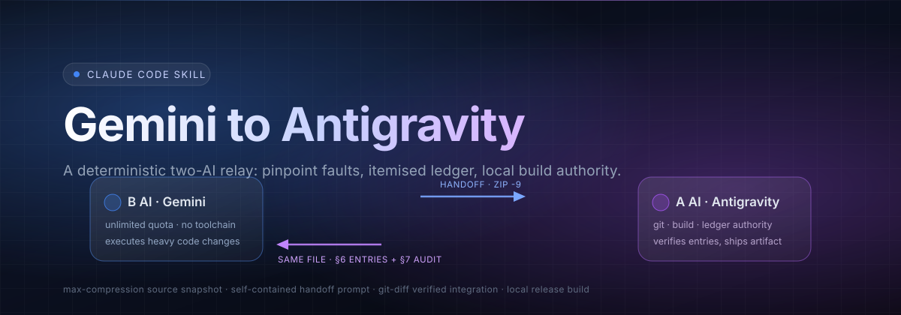
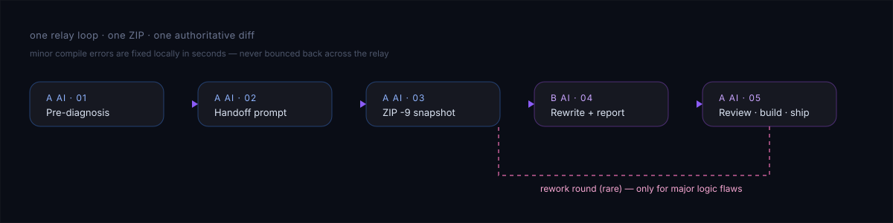

<div align="center">



# Gemini to Antigravity

**确定性的双 AI 接力协议：远端无限配额，本地构建权威。**

[](LICENSE)
[](SKILL.md)
[](https://docs.claude.com/en/docs/claude-code/skills)
[](#隐私与安全)

[English](README.md) · [简体中文](README.zh-CN.md) · [快速开始](#60-秒快速开始) · [技能规范](SKILL.md) · [协议](docs/PROTOCOL.md) · [安装](docs/AGENT-INTEGRATION.md)

</div>

<details>
<summary><b>目录</b></summary>

- [为什么要用](#为什么要用)
- [它解决的问题](#它解决的问题)
- [工作方式](#工作方式)
- [60 秒快速开始](#60-秒快速开始)
- [严谨性来自哪里](#严谨性来自哪里)
- [场景配方](#场景配方)
- [成本与延迟模型](#成本与延迟模型)
- [威胁模型](#威胁模型)
- [仓库结构](#仓库结构)
- [返回契约](#返回契约)
- [兼容性](#兼容性)
- [设计原则](#设计原则)
- [隐私与安全](#隐私与安全)
- [常见问题](#常见问题)
- [路线图](#路线图)
- [参与贡献](#参与贡献)
- [许可证](#许可证)

</details>

---

## 为什么要用

每个认真写代码的智能体都会撞上同一堵墙：推理最强的模型有配额限制，配额无限（或极宽）的模型跑不了编译器。结果就是手工搬 diff、上下文丢失，最后才发现根本编译不过。

**Gemini to Antigravity** 把这种手工搬运固化成一套协议。

本地智能体 —— **A AI**（*Antigravity*：握有仓库、编译器和发布闸门）—— 负责诊断、审查与构建。远端智能体 —— **B AI**（*Gemini*：近乎无限的算力预算，零本地工具链）—— 负责批量代码改写。两端仅由两个产物连接：

```
一个交接 ZIP   ─────────────────────────▶   B AI
一个结果 ZIP   ◀─────────────────────────   B AI
```

其余一切 —— 定位规范、编号账本、执行规则、错误分级 —— 全部被编码，任何一端都不会漂移。

> 名字就是契约。*Gemini* 是你借来的引擎。*Antigravity* 是你永不离开的地面：你的仓库、你的 `git diff`、你的构建产物、你签下的发布。

**核心是「账本」。** A AI 不写任务描述，只写带定位的编号断言 —— `F-01 · src/core/scheduler.ts:112-140 —— 暂停的任务仍会进入 execute()，解引用已释放的 handler` —— 且不写改法。B AI 必须逐个 ID 收尾，边改边向同一份文档追加条目，返回前自行审计全部 ID。A AI 用一个脚本先把账本与 diff 核对一遍，再读第一行代码。**偷懒不再是主观判断，而是一个缺失的 ID。**

---

## 它解决的问题

| 痛点 | 不用本技能 | 用本技能 |
| --- | --- | --- |
| **配额枯竭** | 把顶级模型配额烧在 400 行重构上 | 批量工作推给无限配额模型 |
| **远端无工具链** | 远端写出"看起来对"但永远编译不过的代码 | 本地侧必定编译、类型检查、打包 |
| **盲信** | 接受远端的"已完成"消息 | `git diff` 是事实来源，不是报告 |
| **静默偷懒** | "全部已处理" —— 六项里实际只做了三项 | 每个 ID 必须有条目、状态与行号；`check_ledger.py` 直接点名缺失项 |
| **模糊交接** | "调度器某处有 bug" | 每个问题都带文件名，知道行号就带行号 |
| **改法锚定** | 提示词里画出补丁，模型照抄，对错都由你负责 | 提示词只报问题，改法必须由 B AI 自己推导 |
| **上下文丢失** | 远端做到一半忘了架构 | `GEMINI_HANDOFF.md` 设计上自包含 |
| **接力乒乓** | 为一个漏掉的 import 来回三轮 | 机械性错误本地几秒修完 |
| **归档卫生** | `node_modules/` 把 ZIP 撑到 300 MB | 具名、可审计的排除清单 |
| **包装目录** | 文件多落一层，静默地什么都没覆盖 | 中转解压先归一化根目录 |
| **提交污染** | `GEMINI_HANDOFF.md` 被提交进仓库 | 交接产物显式不纳入版本控制 |

---

## 工作方式

<div align="center">

</div>

```
┌────────────────────────── 阶段一 · 出站 ──────────────────────────┐
│  ① 预诊断    读源码、日志、堆栈                                   │
│              分配 F-nn（带定位的问题，不写改法）                    │
│                   U-nn（逐字需求 + 可验收条件）                     │
│                   S-nn（可疑区域 + 必须回答的问题）                 │
│  ② 交接账本  ZIP 根目录放 GEMINI_HANDOFF.md §1-§8                 │
│              → 问题、需求、可疑、八条执行规则                       │
│  ③ 打包      ZIP_DEFLATED，compresslevel = 9                      │
│              排除 .git、node_modules、build、dist …               │
└───────────────────────────────────────┬───────────────────────────┘
                                        ▼
                     ┌─────────────────────────────────────┐
                     │  B AI / ZIP                         │
                     │  每个 ID：改完立刻追加 §6 条目        │
                     │  返回前：填满 §7 自审表               │
                     └────────────────┬────────────────────┘
                                      ▼
┌────────────────────────── 阶段二 · 入站 ──────────────────────────┐
│  ④ 安全点    git status → commit / 具名 stash                     │
│  ⑤ 中转解压  检查目录布局 → 归一化包装层                           │
│              完整读取 §6 与 §7                                     │
│  ⑥ 账本核验  check_ledger.py：每个 ID 有且仅有 1 条 + 状态          │
│              缺失 / 重复 / 格式错 → 重做                           │
│  ⑦ Diff 审查 git status · git diff --stat · git diff              │
│              每个 DONE 必须真的落在它声称的行上                     │
│  ⑧ 构建闸门  typecheck → 编译 → 测试 → 发布产物                   │
│  ⑨ 分级处理  机械性 → 本地修复重编                                │
│              结构性 → 追加 §9 失败记录，重做                        │
└───────────────────────────────────────────────────────────────────┘
```

---

## 60 秒快速开始

### 安装

```bash
# 个人级技能（所有项目可用）
git clone https://github.com/HIMKUG/gemini-to-antigravity.git \
  ~/.claude/skills/gemini-to-antigravity
```

```powershell
# Windows PowerShell
git clone https://github.com/HIMKUG/gemini-to-antigravity.git "$env:USERPROFILE\.claude\skills\gemini-to-antigravity"
```

也可以把目录放进单个项目的 `.claude/skills/` 下做项目级作用域。

验证加载：

```bash
claude --debug 2>&1 | grep -i gemini-to-antigravity
```

### 出站用法

> "把这个仓库打包给 Gemini。崩溃点在 `src/core/scheduler.ts:112`，把修复交接过去，并让它顺带审计重试路径。"

实际发生：预诊断 → 生成 `GEMINI_HANDOFF.md` → 最大压缩生成 `repo-handoff-<日期>.zip` → 输出精确路径与字节数供你上传。

### 入站用法

> "这是 Gemini 返回的 ZIP。应用它、审查 diff，然后构建 release APK。"

实际发生：安全点 → 中转解压 → 覆盖 → `git diff` 审查 → 构建 → 本地分级修复 → 报告发布产物路径。

---

## 账本模型

三个 ID 命名空间，由 A AI 分配，永不复用：

| 前缀 | 含义 | 声明位置 | 必须包含 |
| --- | --- | --- | --- |
| `F-nn` | **已确认问题** —— 本地已复现 | §2 | 定位、问题描述、证据、不可越过的边界 |
| `U-nn` | **用户需求** —— 原始请求中的一句话，改写为可验收项 | §3 | 逐字片段、验收条件 |
| `S-nn` | **可疑区域** —— 尚属假设 | §4 | 定位、为什么可疑、必须回答什么 |
| `X-nn` | **声明式越界** —— 由 B AI 主动上报的额外改动 | §6 | 理由 |

每个 `F` 与 `S` 的标题都以最精确的定位结尾 —— 行区间、单行，或仅文件名。没有定位的条目只是假设，必须归入 `S`，不能进 `F`。B AI 为每个 ID 写恰好一条条目和一行审计；只要某个 ID 缺席，A AI 就不接受这一轮。

---

## 严谨性来自哪里

### 1 · 交接提示按契约自包含

B AI 不认识本技能、这个仓库或之前的对话。它必须遵守的每条不变量全部写在 `GEMINI_HANDOFF.md` 里：

| 章节 | 保证 |
| --- | --- |
| **§1 用户原始需求（逐字）** | 不允许改写漂移，需求逐字节穿越运输 |
| **§2 问题账本（`F-nn`）** | 标题带定位，问题描述 + 证据 + 边界；**不写改法** |
| **§3 需求账本（`U-nn`）** | 用户的每句话改写为可观察的验收条件 |
| **§4 可疑区域（`S-nn`）** | 点名盲区，并给出 B AI 必须回答的具体问题（哪怕答案是"干净"） |
| **§5 执行规则** | 八条规则写进文件：逐 ID 追加、不合并 ID、不碰未登记文件 |
| **§6 执行账本** | 每个 ID 一条，边做边写，含文件、行号、验证方式 |
| **§7 自审表** | 每个 ID 一行；每个 DONE 必须指向能证明它的行号 |
| **§8 返回契约** | 同一份文件回传，§6 §7 填满 —— 没有可用来"总结"的独立报告 |

### 1b · 有定位才是问题，没定位就是假设

```
### F-01 · src/core/scheduler.ts:112-140     ← 知道行区间
### F-02 · src/core/scheduler.ts:131          ← 只知道单行
### F-03 · src/core/scheduler.ts              ← 只知道文件
### S-01 · src/core/queue.ts                  ← 未验证 → 可疑区，绝不是问题
```

这一条消除了智能体交接里最常见的失败：一段自信的长文，不点名任何文件，远端模型于是"在某个像样的地方"改了点什么。没有定位就没有可核对的对象，所以该条目降级为可疑区，必须被回答，而不是被悄悄关掉。

### 1c · 只报问题，不报改法

`F-nn` 说明：代码现在做什么、必须做什么、什么输入会触发、失败长什么样。不写补丁，不写目标 API。

理由是审查的独立性。写下改法后，审查就变成"B AI 有没有实现我的想法"；只写问题，审查才是"这个问题还在不在"。后者才是唯一重要的问题，也是唯一无法靠点头附和蒙混过去的问题。

### 2 · 归档是规格，不是倾倒

| 包含 | 排除（黑名单） |
| --- | --- |
| 完整源码树、全部配置、锁文件、资源 | `.git/` |
| 根目录 `GEMINI_HANDOFF.md` | `node_modules/`、`.venv/`、`__pycache__/` |
| 与 `.gitignore` 相关的源码文件 | `target/`、`build/`、`dist/`、`.gradle/`、`.dart_tool/` |
| 逐字节保留的相对目录结构 | `.idea/`、`.vs/`、`.DS_Store` |

压缩：`zipfile.ZIP_DEFLATED` + `compresslevel=9`（跨平台、无需外部二进制），或可用的 `zip -9 -r`。写完即校验：根目录存在 `GEMINI_HANDOFF.md`、相对布局完整保留。

### 3 · 集成是双钥匙操作

你永远不会把远端归档直接解到工作树。两道闸门：

1. **安全点** —— 先 `git status`；提交或建具名 stash，覆盖前状态永远可恢复。
2. **中转解压** —— 解到临时目录，识别包装层（`project_name/`），归一化源码根，**先读完 §6 与 §7 再复制任何文件**。

### 4 · 账本核验先于 Diff 审查

```bash
python scripts/check_ledger.py returned/GEMINI_HANDOFF.md --strict
```

脚本从 §2–§4 读出全部 ID，逐条断言：

- 每个 ID 在 §6 有且仅有一条条目，且 `STATUS` 合法
- 每个 ID 在 §7 有且仅有一行，且状态与 §6 一致
- 每个 `DONE` 都写了文件与行号
- 每个 `FAILED` 都写了阻塞点与停止位置
- 没有重复 ID，没有未声明的条目

任何违规即退出码 `1` 并点名。它在一秒内跑完，先于读任何 diff —— 偷懒的一轮一秒判死，而不是读完一遍才发现。

### 5 · Git 是裁判

账本只是*主张*，`git diff` 才是*证据*。两者按序核对：

- 先跑 `check_ledger.py` —— 完整性检查便宜，就先做便宜的
- `git status`、`git diff --stat` 看清影响面
- 完整 `git diff` 判断意图
- 每个 `DONE` 都必须真的落在它声称的行上
- 同时对照 §2（问题）、§3（验收条件）与逐字原始需求
- 主动排查截断、格式噪声、越界改动

`DONE` 声称的行没有被 diff 触碰，就是虚假主张，在重做轮里按缺失 ID 对待。

### 6 · 错误分级是决策，不是条件反射

| 类别 | 例子 | 动作 |
| --- | --- | --- |
| **机械性** | 缺 import、漏依赖声明、语法笔误、可见性不匹配 | 本地修复、重编、发布 |
| **结构性** | `F-nn` 未修、`U-nn` 未达、`S-nn` 未答复、条目与 diff 矛盾 | 停止打补丁；追加 §9；重发 |

本地补一个 import 只要几秒，远端一次人肉接力要一整个来回。协议禁止把它打回去 —— 账本核验失败的一轮没有进入审查，所以不消耗重做名额。

### 7 · 重做时追加「失败记录」

失败的一轮不重写，而是**续写**。§9 追加到 B AI 必须继续书写的同一份文件：

```markdown
## 9. 第 2 轮 —— 失败记录（由 A AI 书写）

### 未兑现的主张
- F-01：§6 声称 DONE 于 `scheduler.ts:112-140`，`git diff` 在该区间无改动。
- F-03：完全没有条目，未尝试。

### 构建证据
<逐字编译器输出，截到最后几行错误>

### 漂移
<出现在 diff 中、但没有任何条目提及的文件，附行区间>

### 本轮要做的事
只重开上面列出的 ID；已有的条目保留；为返工追加新条目。
```

B AI 于是要在它必须继续追加的同一份文档里，逐条读自己的失败。这就是设计上的压力：偷懒的一轮，代价是把自己的错误写成一份完整的文档。

---

## 场景配方

针对本协议存在的四类情境，可直接复制的提示词。

### 配方 A · 修复间歇性崩溃

```text
出站："打包给 Gemini。F-01 是 src/core/scheduler.ts:112-140 —— 暂停的任务
仍会进入 execute()，解引用已释放的 handler。S-01：queue 出队路径。
逐个收尾 ID、追加账本、完成自审。"
入站："中转解压、跑 check_ledger.py、审查 diff、类型检查、跑测试、构建。"
```
生效的分级规则：构建中暴露的缺失 import 在本地补，绝不打回。

### 配方 B · 无限配额上做全新功能

```text
出站："交接设置页功能。U-01..U-04 改写用户原话。S-01：导航注册表。
S-02：主题 token。交付完整树；任何删除都必须单独一条条目并说明理由。"
入站："中转解压、核验账本、审查越界改动，然后构建并冒烟测试。"
```
全新功能没有 `F-nn`，绊线在 `S-nn`：三个可疑项却没有任何 §6 条目，说明这一轮根本没查。

### 配方 C · 机械性横扫（改名、格式化、依赖升级）

```text
出站："全仓库把 TaskHandler 改名为 JobHandler。U-01：所有引用编译通过。
S-01..S-03：三处动态查找点。返回完整树；从未提及该符号的文件可跳过。"
入站："应用后逐个确认 DONE 落在它声称的行上，并核对 git diff --stat 与
本地 grep 计数一致。"
```
横扫最适合激进审查 diff：符号引用之外的改动都是漂移，而漂移的表现就是"某个文件出现在 diff 里、却不在任何条目里"。

### 配方 D · 移植或迁移

```text
出站："把 src/legacy/export.ts 从 CommonJS 移植到 ESM。F-01..F-06 是六处
调用点，均带行号。S-01：动态 require。S-02：barrel 文件。"
入站："应用、逐处审查 import 重写，然后跑完整包构建。"
```
移植失败常因*遗漏*，所以先读自审表：六个 `F-nn` 里出现四个 `NOT-APPLICABLE` 且无理由，就是跳过了自查的一轮。

---

## 成本与延迟模型

为什么"双产物"设计优于随手复制粘贴：

| 因素 | 聊天式复制粘贴 | 本协议 |
| --- | --- | --- |
| 前沿模型 token | 高 —— 每轮重新解释仓库 | 低 —— 只看到审查过的 diff |
| 远端模型 token | 按粘贴计费，格式有损 | 一个 `-9` 归档，结构完整 |
| 机械性错误往返 | 2–3 次 | 0 次 —— 本地修复 |
| 结构性错误往返 | 2 次以上且上下文丢失 | 1 次，附带日志与 diff 片段 |
| 每轮人工注意力 | 重粘、重讲、重信任 | 审 diff，批准或驳回 |
| 可复现性 | 无 —— 每次粘贴都不同 | 归档 + 逐字需求 = 可审计 |

归档是工作单元，其余都是对该单元的审查步骤。

---

## 威胁模型

本协议防御什么，以及不防御什么。

| 威胁 | 缓解 | 残余风险 |
| --- | --- | --- |
| 密钥泄入交接包 | `.env*`、`*.pem`、`*.key` 黑名单，打包器写后扫描 | 以异常文件名伪装的密钥 |
| 破坏性覆盖 | 写前 Git 安全点；中转解压 | 从未 stash 的本地未提交改动 |
| 静默删文件 | 任何删除都必须有条目点名路径 | 删了却没有条目 —— 由 `git status` 与漂移检查捕获 |
| 越界改动 | 完整 `git diff`；任何未登记文件都算漂移 | 超大 diff 的审查疲劳 —— 拆分交接 |
| 声称做了却没做 | `check_ledger.py` + 逐个 `DONE` 核对行号 | 写了真实行号但改错了内容 —— 由审查与测试兜底 |
| 远端代码不可构建 | 本地强制构建闸门 | 能构建但行为错误 —— 由测试兜底 |
| 供应链注入 | 任何新依赖必须在进入构建前有对应条目 | 加了依赖却没有条目 —— 由锁文件 diff 捕获 |
| 归档炸弹 / 超大 ZIP | 排除清单 + 字节数报告 | 确实应进归档的二进制资源 |

不防御：恶意远端模型在请求范围内植入后门逻辑。diff 审查与测试是你唯一的控制手段 —— 读 diff，永远不要读摘要。

---

## 仓库结构

```
gemini-to-antigravity/
├── SKILL.md                      # 技能本体：面向智能体的规范
├── README.md                     # 英文说明
├── README.zh-CN.md               # 简体中文说明（本文件）
├── LICENSE                       # MIT
├── assets/
│   ├── banner.svg                # README 头图
│   └── flow.svg                  # 接力示意图
├── examples/
│   ├── GEMINI_HANDOFF.example.md # 出站 + 回传账本完整示例
│   └── GEMINI_HANDOFF.lazy-round.md # 故意写坏的返回，用于校准检查器
├── scripts/
│   ├── pack_handoff.py           # ZIP -9 打包 + 写后校验
│   └── check_ledger.py           # 账本完整性闸门，先于审查运行
├── docs/
│   ├── PROTOCOL.md               # 形式化不变量、状态机、一致性清单
│   ├── AGENT-INTEGRATION.md      # 安装到 Claude Code、Cursor、Codex、MCP
│   ├── COMPARISON.md             # 与复制粘贴、补丁接力、分支交接对比
│   └── OPERATIONS.md             # 轮次规模、调度、升级处置手册
└── .github/workflows/validate.yml # CI：schema、打包器冒烟、链接检查
```

| 文档 | 何时读 |
| --- | --- |
| [SKILL.md](SKILL.md) | 你是执行一轮接力的智能体 |
| [docs/PROTOCOL.md](docs/PROTOCOL.md) | 需要形式化不变量或一致性清单 |
| [docs/AGENT-INTEGRATION.md](docs/AGENT-INTEGRATION.md) | 正在把本技能装进某个运行时 |
| [docs/COMPARISON.md](docs/COMPARISON.md) | 正在判断本协议是否适用 |
| [docs/OPERATIONS.md](docs/OPERATIONS.md) | 某轮失败，或准备连做多轮 |
| [examples/](examples) | 想要可直接照抄的交接与账本 |
| [CHANGELOG.md](CHANGELOG.md) | 想知道改了什么、为什么改 |

---

## 返回契约

B AI 只回一个 ZIP：

```text
<result>.zip
├── <源码树，相对布局不变>
└── GEMINI_HANDOFF.md      # 同一份文件，§6 与 §7 现已填满
```

没有独立报告。A AI 写的文件就是 B AI 写完的文件 —— 需求、账本、自审、返工记录都在同一处，没有任何一项可以被"总结"掉。

§6 条目格式：

```markdown
### F-01
- **STATUS:** DONE            # 或 FAILED / NOT-APPLICABLE
- **Files:** src/core/scheduler.ts
- **Lines:** 112-136
- **Change:** 到期检查之前先排除暂停任务；保留旧的 nextRunAt，恢复仍可用。
- **Verified:** 复现测试通过；暂停任务不再进入 execute()。
```

失败条目也是合格条目 —— 前提是具体：

```markdown
### U-03
- **STATUS:** FAILED
- **Blocker:** release 构建需要 Android SDK，本 ZIP 内不存在。
- **Stopped at:** build.gradle.kts:41
- **Tried:** 离线执行 gradle assembleRelease，依赖解析失败。
```

让这套契约可执行的两句话：**没有条目的 ID 就是未完成的一轮；条目声称的行若未被 diff 触碰，就是虚假主张。**

---

## 兼容性

| 环境 | 支持 |
| --- | --- |
| Claude Code（CLI / 桌面 / IDE） | ✅ 自动从 `~/.claude/skills` 发现 |
| 任何读取 `SKILL.md` 的智能体运行时 | ✅ 纯 Markdown + YAML frontmatter |
| 仓库语言 | ✅ 语言无关：TS、Python、Rust、Kotlin、Dart、C++ 等 |
| 发布目标 | ✅ 二进制、安装包、APK、Bundle、容器 |
| 操作系统 | ✅ Windows、macOS、Linux |
| 网络 | ❌ 不需要 —— 接力设计上基于文件 |

---

## 设计原则

1. **本地权威不可让渡。** 持有编译器的一方永远拥有最终解释权。
2. **有定位才是问题。** 没有文件的发现只是假设，就按假设归档。
3. **只报问题，不报改法。** 写死改法会摧毁审查的独立性。
4. **一项一条目。** 摘要正是工作蒸发的地方，编号条目则无处可躲。
5. **产物优先于承诺。** ZIP、账本与 diff 高于任何"已完成"的散文。
6. **规则随载荷同行。** 自包含提示优于隐含上下文。
7. **便宜修复保持便宜。** 机械性错误不配一次接力来回。
8. **最小干净归档。** 被排除的字节即被排除的风险。
9. **默认可逆。** 每次覆盖前必有安全点。
10. **无隐藏状态。** 整套协议就是本仓库里可读的 Markdown。

---

## 隐私与安全

- **无遥测。** 技能不发起网络请求，不向任何地方上报。
- **无凭据。** 交接产物只含源码，绝不含 `.env`、令牌或密钥。敏感仓库请自行把密钥模式加入排除清单。
- **人在回路。** ZIP 由你自己上传，不存在自动外发。
- **交接文件不入库。** `GEMINI_HANDOFF.md` 不进入提交，仓库历史保持干净。

---

## 常见问题

**为什么不直接用配额更大的单一模型？**
因为配额与工具链极少同处一地。本协议让你组合两者优势而不丢发布闸门。

**A AI 可以是别的本地智能体吗？**
可以。任何能读写文件、跑 `git`、执行构建的都合格，`SKILL.md` 与模型无关。

**B AI 必须用 Gemini 吗？**
不必 —— 任何能接收 ZIP 并返回 ZIP 的远端模型都行，契约就是接口。

**交接包能多大？**
由排除后的源码决定，通常几 MB。二进制资源是实际上限，超大媒体建议改用清单引用。

**B AI 返回带包装目录怎么办？**
这是预期情况，中转解压会归一化。它是远端 ZIP 最常见的失败模式，已被显式处理。

**B AI 删了我需要的文件？**
删除只有在一个 §6 条目点名该路径时才合法。没有条目的删除属于协议违规，由 `git status` 与漂移检查暴露。

**怎么知道 B AI 真的全做完了？**
跑 `check_ledger.py`。它列出全部已声明 ID，断言每个都有条目和审计行，并标记所有缺文件/行号的 `DONE`。缺失 ID 意味着该项根本没尝试 —— 在第一秒就知道，而不是读完一段自信的摘要之后。

**为什么不保留独立的变更报告？**
因为报告是摘要，摘要是最容易"声称完成而不完成"的地方。账本强制一项一条目、边做边写，而且写在承载需求的那份文件里。

**为什么不告诉 B AI 怎么改？**
因为那样审查就变成"有没有照我的猜测做"，而不是"问题还在不在"。只写问题的提示，让审查回答真正重要的那个问题。

**支持 monorepo 吗？**
支持。排除清单按相对路径生效，布局逐字保留，工作区结构完好。

**有自动打包器吗？**
有 —— [`scripts/pack_handoff.py`](scripts/pack_handoff.py) 用默认黑名单产出 `-9` 归档，并校验交接文件位于根目录、未混入任何密钥文件。

**有自动账本检查吗？**
有 —— [`scripts/check_ledger.py`](scripts/check_ledger.py)，零依赖，任何缺失或格式错误的 ID 都返回退出码 `1`。在读 diff 之前跑，永远不要之后跑。

---

## 路线图

- [x] 返回账本的完整性闸门（`check_ledger.py`）
- [x] 逐项自审表，带行级证据
- [x] 返工轮追加失败记录，而不是重写提示
- [ ] 自动核对每个 `DONE` 的行号是否真在 diff 中
- [ ] 可配置黑名单档案（`web`、`android`、`python`、`monorepo`）
- [ ] `GEMINI_HANDOFF.md` 预检 lint：每个 `F-nn` 有定位、无改法措辞
- [ ] 多轮接力历史与逐轮检查点

见 [Issues](https://github.com/HIMKUG/gemini-to-antigravity/issues)，欢迎提案。

---

## 参与贡献

先读 [CONTRIBUTING.md](CONTRIBUTING.md)，然后提 PR。保持 `SKILL.md` 与模型无关、协议可读、diff 精简。

```bash
git clone https://github.com/HIMKUG/gemini-to-antigravity.git
cd gemini-to-antigravity
git checkout -b feat/your-change
```

---

## 许可证

MIT © 2026 HIMKUG —— 见 [LICENSE](LICENSE)。

<div align="center">

**借来引擎，守住地面。**

<sub>为真正交付的智能体而建，不为聊天的智能体而建。</sub>

</div>
